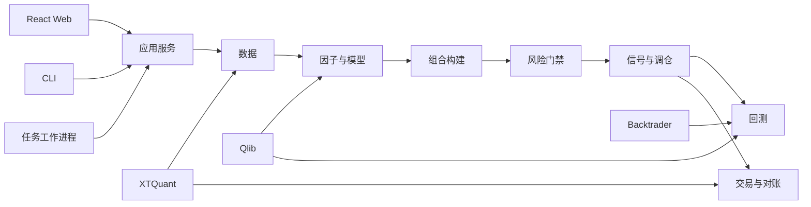

# QuantKing V3 总体架构

## 文档状态

本文描述已确认的目标架构。Stage 0 已于 2026-07-16 完成验收，Stage 1 已获实施授权并进行中，但尚未完成；实现状态以 [路线图](ROADMAP.md) 为准。架构决策以 [DECISIONS.md](DECISIONS.md) 为最高依据。

## 架构风格

QuantKing V3 是本地模块化单体：领域和应用逻辑位于一个 Python 包中，FastAPI、CLI、后台任务和 QMT 访问复用同一套应用服务。进程隔离用于稳定性和资源管理，不构成微服务。



## 进程

| 进程 | 职责 | 限制 |
|---|---|---|
| Web/API | 提供同源 API、静态前端、SSE 与输入校验 | 不执行长任务，不包含业务规则 |
| Worker | 串行或受控并发执行下载、因子、训练、回测、备份 | 每个任务必须持久化状态和日志 |
| QMT 访问 | 在受控进程中完成行情或账户只读调用 | 不暴露任何下单能力 |
| CLI | 诊断、维护、离线运行和验收 | 调用同一应用服务，不复制逻辑 |

Stage 0 可将 Worker 和 QMT 访问放在同一工作进程，后续仅在稳定性证据要求时拆分进程。

Web 与 Worker 之间不建立内存队列。Worker 将低频任务状态和进度写入 SQLite `JobEvent`；Web 按单调事件游标读取后向浏览器发送 SSE。完整 JSON Lines 日志由受控日志读取适配器按文件偏移尾随，不把每条日志复制进 SQLite。

## Python 模块

```text
src/quantking/
  common/       ID、时间、版本、错误、配置、日志基础
  data/         数据接入、标准化、质量、版本与发布
  research/     因子、标签、数据集、实验与模型
  portfolio/    分数到目标组合、换仓与资金分配
  risk/         风险规则、检查结果与覆盖审批
  backtest/     Qlib 快速回测和 Backtrader 正式回测
  signals/      目标组合、调仓计划和生命周期
  trading/      账户、委托、成交、策略账与对账
  jobs/         持久化任务、取消、恢复和进度
  web/          FastAPI 路由、API schema、前端托管
  cli/          命令行入口
```

复杂模块使用轻量内部结构：

```text
module/
  models.py        领域对象和数据契约
  ports.py         不稳定外部边界
  services.py      用例和流程编排
  repositories.py  持久化接口
  adapters/        外部 SDK、数据库或引擎实现
```

不为每个小函数机械套用层级。端口只用于 XTQuant、备用源、Qlib、Backtrader、数据库、文件系统和时钟等需要替换或隔离的边界。

## 依赖方向

- `portfolio` 接收标准预测分数，不导入 Qlib。
- `risk` 依赖稳定业务对象，不导入 Backtrader、XTQuant 或 FastAPI。
- `signals` 不直接查询券商；它基于账户快照和策略账生成计划。
- `trading` 只实现读取、匹配、确认和对账，不提供下单端口。
- `web`、`cli` 和 `jobs` 调用应用服务，不自行实现领域规则。
- 供应商 DataFrame、回调对象和异常不得越过适配器边界。
- 批量数据可使用 Pandas、Arrow 和 DuckDB；交易计划、审批、成交和审计使用类型明确的业务对象。

## 核心对象

| 对象 | 作用 |
|---|---|
| `DatasetVersion` | 标识一次通过质量门禁的数据发布 |
| `FactorDefinition` / `FactorSetVersion` | 定义因子语义和集合版本 |
| `ExperimentRun` | 绑定数据、股票池、标签、切分、参数和产物 |
| `ModelVersion` | 可审批、启用和停用的模型版本 |
| `PredictionSet` | `date × code → score` 的不可变输出 |
| `TargetPortfolio` | 某信号日的目标股票和权重 |
| `RiskAssessment` | 风险检查结果、级别和覆盖记录 |
| `RebalancePlan` | 当前组合到目标组合的版本化调仓意图 |
| `BrokerSnapshot` | QMT 账户资产、持仓、委托和成交快照 |
| `Fill` | 原始成交明细及其策略归属 |
| `ReconciliationIssue` | 计划、策略账与券商总账的差异 |
| `JobRun` | 长任务状态、输入、日志、产物和失败信息 |
| `JobEvent` | 可跨进程恢复的低频任务状态和进度事件 |

## 主链路

### 数据发布

```text
数据源 → Raw 批次 → 标准化 → 质量检查 → Canonical 临时版本
      → 清单与校验和 → 原子发布 DatasetVersion
```

### 研究与模型

```text
DatasetVersion + 股票池规则
    → Qlib 派生数据
    → 因子和标签
    → 时间切分
    → 线性/Ridge 与 LightGBM
    → 实验记录
    → 模型审批
    → PredictionSet
```

### 组合与回测

```text
PredictionSet → 动态股票池 → Top 30 基本等权
    → 5% 单股上限 + 3% 现金 + 换仓限制
    → RiskAssessment → TargetPortfolio
    ├─ QuantKing Qlib Strategy 适配器 → Qlib 快速回测
    └─ Backtrader 正式回测
```

Qlib Strategy 适配器按日期读取已经生成的 `TargetPortfolio`，不得从 `score` 再次选股或计算目标权重。Qlib 内置组合构造策略只可用于明确标记的外部基准实验，不得进入 QuantKing 双引擎校准或正式候选策略结论。

### 调仓与对账

```text
TargetPortfolio + 已确认策略账 + BrokerSnapshot
    → RebalancePlan → 用户批准 → QMT 人工下单
    → 只读同步成交 → 待确认匹配 → 用户确认
    → 策略账更新 → 总账/子账对账
```

## 物理存储

```text
E:\QuantKingV3Data\
  raw\          各来源不可变原始批次
  warehouse\    标准 Parquet 数据版本
  qlib\         Qlib 派生视图
  artifacts\    因子、模型、回测和正式报告
  logs\         运行和任务 JSONL 日志
  backups\      本地恢复快照
  quantking.db  元数据、任务、审计、账务和对账

F:\QuantKingV3Backups\
  ...           异盘灾难备份
```

SQLite 使用 WAL 模式、连接级 `busy_timeout`、短事务和针对锁冲突的有界指数退避；任何训练或回测不得在数据库事务中执行。心跳采用合并写入，完整日志不进入 SQLite。Parquet 发布使用临时目录和原子重命名。DuckDB 是查询引擎，不是业务状态数据库。

## 运行触发

首期日常 EOD 链路由用户从 Web 或 CLI 手动触发，两种入口调用同一应用服务。系统不建设内部定时调度器，也不依赖 Windows 任务计划；以后引入无人值守调度必须重新评审失败恢复、幂等和用户授权边界。

## 配置

- 仓库保存无机密默认配置和 schema。
- 本机路径、QMT 账号、券商费率和敏感配置放在不入 Git 的本地配置中。
- 影响研究、回测、风险或调仓的参数修改必须生成配置版本。
- 正式实验和计划引用配置版本，而不是隐式读取当前配置。

## 安全边界

- Web 只绑定 `127.0.0.1`，默认不启用 CORS 或远程访问。
- API 不接受任意 Python 表达式、任意模型路径或任意文件系统路径。
- 模型只从受管理产物目录加载，并验证清单和校验和。
- 日志掩码账户标识，不写密码、令牌或完整敏感配置。
- 任何自动下单入口都属于架构违规。

## 状态声明

以上除已验收的 Stage 0 工程基线外均为目标结构。当前确认 Stage 0 工程能力；
Stage 1 S1-01 已于 2026-07-16 完成主验收（数据合同、元数据持久化与安全迁移基础），
S1-02 已于 2026-07-18 在提交 `79f9fa3e682e212cf74e7886a04c6fb52158f302`
完成主验收（Warehouse、原子发布与显式版本查询）。S1-03-R1 已于 2026-08-05 完成离线/防御性独立主验收；
该适配器只产生经验证的 Canonical 候选表，五类未获源码证据支持的供应商能力继续归入 S1-07C 并安全失败，
不会发布 DatasetVersion。S1-04 已于 2026-07-22 在提交
`2f99491e9dc410acf85ca81c131a77cae08d0cc3` 完成主验收；真实备用源验证仍须逐项授权。
S1-05 已于 2026-07-27 在提交 `e580d6963e01b1301dc26f29ed57a0b5b4770a0f`
完成主验收。CLI 和 Web API 共用同一个 EOD Command Service，
只创建持久 `data.eod.v1` Job；显式 Worker 按 `job_id` claim 后在事务外串联现有
ingestion、QualityRunner 和 CanonicalPublishCoordinator，并生成 SHA/COMPLETE 绑定的
不可覆盖 EOD 证据。没有后台轮询器、Windows 计划任务、自动切源或隐式发布。
正式入口只接受精确基版本 ID，并在入队时复验其 Warehouse/Quality 血缘；通用 runtime
不恢复 RUNNING，显式 Worker 只按持久 heartbeat 租约条件恢复。frozen command 同时约束
Worker 与 evidence，lookback 使用实际 FetchChunk 作为权威替换切片。
R1 进一步固定显式 base version 凭证，以完整基表加本次供应商响应构建完整快照；全覆盖
请求采用 `REUSED_UNCHANGED`，新版本采用 `PUBLISHED_NEW`。正式 CLI/Web 入口使用同一
类型化 runtime，XTQuant SDK 只在显式 Worker 实际 fetch 时延迟加载。深层证据 verifier
绑定 SQLite、PASSED QualityRun 和 Warehouse，发布 checkpoint 支持发布后故障恢复。
R3 将 success/failure 终态证据与 JobRun 三类持久 manifest 精确交叉绑定，并让 Worker
在质量和不可取消发布阶段持续续租；若 provisional success 后最终状态提交失败，显式
stale recovery 会保留 forensic success、写入权威 INTERRUPTED 证据并使重试严格复用
唯一 checkpoint 版本。
R4 使已有 failure evidence 的 stale recovery 成为严格幂等协调：证据、JobRun、完整
发布血缘和 checkpoint 一致时复用原字节，否则安全阻断。failure 终态 verifier 与 success
采用同一深层 DatasetVersion、batch、QualityRun 和 Warehouse 验证；Worker 在续租线程
停止并 join 后才进行 SUCCEEDED/FAILED/CANCELLED 条件提交。
R5 将 handler 的发布后观察与终态 evidence 收敛到同一套状态感知 completed-result
验证：新发布版本直接绑定冻结 base 和本次 batch；未变化结果则指向冻结 base 本身，
同时保持该 base 的真实历史 parent 与原始 input batches，禁止自指或伪造父血缘。
S1-06 已于 2026-07-28 在提交 `413805074b3a82c2d2a090d2b73c854a238e2e19`
完成主验收：framework-neutral 查询服务通过窄 port
组合元数据仓储、严格 Warehouse/DifferenceReport verifier、DuckDB 显式版本预览和
既有 Job/EOD 服务。统一报告 loader 与 Override loader 在读侧精确绑定持久血缘和已验证
manifest；Cursor 绑定完整查询指纹；Web 路由不读取 SQLite、Parquet 或 artifact。
Override 读模型同时验证 override、latest application、active binding、attempt 和 child 的
双向状态矩阵；总览失败数通过数据与 Job 仓储窄端口执行 SQL 聚合，范围与统一失败列表一致。
S1-07A 已于 2026-07-29 在提交 `37512be531e15bbd5a698e6a227b0753781ef5e6`
完成主验收。该验收仅覆盖离线验证框架及其信任边界；24 个 source×dataset 单元仍为
BLOCKED_EXTERNAL_VALIDATION，真实运行数为 0。
S1-07B 已于 2026-08-04 在提交 `d60559601efd61de15b41ffa86b4f2f730a69d5e` 完成主验收：权威核心样本 v4、首个 AUTHORITY_APPROVED
case（603377.SH ST）、reference bundle v3 证据链和按 case 放行运行时已定版；
17 个 purpose 仍是覆盖 backlog，不是 S1-07B 全局阻断门。
S1-07C/D、S1-08 尚未开始、未获授权。各模块状态以
[IMPLEMENTATION_PLAN.md](IMPLEMENTATION_PLAN.md)、[路线图](ROADMAP.md) 和 Stage 1
任务卡为准。
