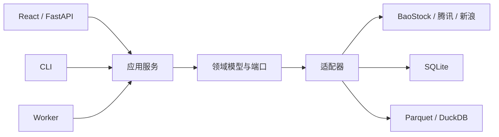

# QuantKing V3 总体架构

## 架构风格

系统采用本机模块化单体：一个 Python 应用承载领域与应用服务，FastAPI 提供本机接口，React
提供界面；长任务通过 SQLite 持久化队列和显式 Worker 执行。模块边界优先于进程拆分，不建设
微服务、消息中间件或远程控制面。



## 依赖方向

依赖只能从入口和适配器指向应用/领域层：

```text
Web / CLI / Worker
        ↓
Application services
        ↓
Domain models + ports
        ↑
Adapters / persistence / third-party libraries
```

- 业务、研究、组合和 Web 层不得直接导入 BaoStock、AKShare、Qlib 或 Backtrader。
- FastAPI `Request`、SQLAlchemy、PyArrow 等框架对象不得成为领域契约。
- 第三方异常在适配器边界转换为稳定、脱敏的项目错误。

## 主要模块

| 模块 | 职责 |
|---|---|
| `common` | 配置、ID、时间、路径和稳定错误 |
| `jobs` | 持久化任务、事件、日志、取消、重试与备份 |
| `data` | 来源适配、Raw、Canonical、质量、比较、仲裁和发布 |
| `research` | 研究输入、股票池、标签、因子与 Qlib 适配 |
| `portfolio` | 目标权重和组合约束 |
| `backtest` | Qlib/Backtrader 适配与统一回测合同 |
| `risk` | 风险门禁和审批状态 |
| `signals` | 人工调仓计划 |
| `trading` | 文件/人工成交与持仓对账，不连接券商 |
| `web` | 本机 API、SSE 和页面组合 |

后续 Stage 尚未实现的模块可以保留最小边界，但不得提前建设业务状态机。

## 数据主链

```text
来源响应
  → append-only Raw + manifest
  → Canonical 候选
  → 单源质量
  → 跨源比较与 ResolutionDecision
  → 最终质量
  → manifest + COMPLETE
  → 原子发布 PUBLISHED DatasetVersion
```

正常日线任务调用 BaoStock A 与腾讯 B；只有受影响范围才调用新浪 C。至少两个实际持有同一主键
行的独立来源在冻结阈值内一致才允许发布。共同缺行不构成值共识；合法整范围空结果必须绑定
交易日历并使用独立原因码。

## 存储

- `E:\QuantKingV3`：Git 代码、配置模板和冻结验收证据。
- `E:\QuantKingV3Data`：运行数据、SQLite、Raw、artifact、Warehouse 和任务日志。
- `F:\QuantKingV3Backups`：异盘灾难备份。
- SQLite 保存任务和版本元数据；Parquet 保存批量数据；DuckDB 只读查询 Parquet。
- 临时目录完成写入、校验和 manifest 后才可原子发布；已发布目录不可修改。

## 运行与安全边界

- Web 只监听 `127.0.0.1`；首期任务由 Web 或 CLI 手动触发，不内置调度器。
- 不连接 QMT、券商 SDK 或交易账户，不保存券商凭据，不提供下单入口。
- 真实网络、正式数据根、旧项目读取和 F 盘写入按任务单独授权。
- 授权机制用于防误执行、范围扩大和意外重放，不建设机构级密码学审批系统。

## 复杂度边界

- 一个领域概念只拥有一个生产状态机和一个权威契约。
- 历史 schema、迁移和 evidence 通过兼容读取保留，不进入当前运行时命名和控制面。
- 当前架构事实写在本文件；阶段状态只在 [路线图](ROADMAP.md) 维护；执行历史只写入对应
  Stage 的实施与验收记录。
