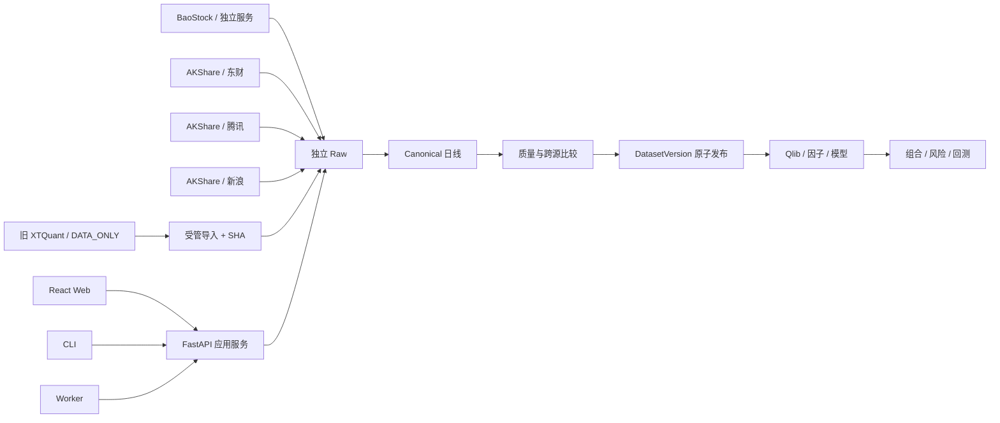

# QuantKing V3 总体架构

## 架构风格

本项目是本地模块化单体。领域和应用逻辑位于一个 Python 包中，FastAPI、CLI 和 Worker 复用同一应用服务；不拆微服务、不引入远程队列。



## 依赖方向

```text
Web / CLI / Worker
        ↓
Application services
        ↓
Domain
        ↓
Ports
        ↓
Adapters
```

- BaoStock、AKShare、Qlib、Backtrader、数据库和文件系统依赖只出现在适配器或入口层。
- Web 不直接读 SQLite、Parquet、日志或供应商对象。
- 业务层只处理稳定的 Canonical、DatasetVersion、QualityRun、DifferenceReport 等对象。

## 主要模块

| 模块 | 职责 |
|---|---|
| `common` | 配置、时间、ID、错误 |
| `data` | 采集、Raw/Canonical/Warehouse、质量、发布、查询 |
| `jobs` | 持久任务、Worker、事件和日志 |
| `research` | 数据集、因子、标签、实验 |
| `portfolio` | 目标权重 |
| `risk` | 独立风险门禁 |
| `backtest` | Qlib 与 Backtrader 适配 |
| `signals` | 人工调仓计划 |
| `web` | 本机 UI 和 API |

## 数据主链

```text
手动触发 EOD
  → BaoStock(A) + 东财(B) 独立抓取
  → Raw 只追加
  → 统一未复权日线
  → A/B 比较
  → 异常时腾讯(C)，仍无共识才调用新浪(D)
  → 两源一致才形成候选
  → ResolutionDecision
  → 质量门
  → 临时目录 + manifest + COMPLETE
  → 原子发布 DatasetVersion
```

失败任务保留日志、输入和失败目录，不污染已发布版本。来源替换允许细化到证券/交易日，但必须显式记录，禁止静默混合。

Stage 1 的生产主链只处理 `daily_bar_unadjusted`。其他历史 schema 是后续阶段的静态合同，不进入 EOD 默认分支。

## 复杂度边界

- 来源模型固定为 `BAOSTOCK`、`AKSHARE/EASTMONEY|TENCENT|SINA`，以及仅用于受管历史导入
  的 `XTQUANT_LEGACY`；不恢复候选供应商审批矩阵。
- A/B/C/D 仲裁是正常解析，由 `ResolutionDecision` 记录，不经过 `SourceOverride` 审批状态机。
- EOD 的权威恢复事实只有冻结 `JobRun`、Raw manifest、DatasetVersion manifest 和 JSON Lines。中断任务失败关闭，新 Job 通过输入指纹复用完整发布。
- K1/K2 不新增 evidence envelope、签名、claim、attempt、forensic/authoritative 双终态或额外 checkpoint 层。
- Web/CLI/Worker 复用应用服务；内部简单函数不为了测试而机械包装 Protocol。

## 存储

| 内容 | 位置 |
|---|---|
| SQLite | `E:\QuantKingV3Data\metadata` |
| Raw | `E:\QuantKingV3Data\raw` |
| Warehouse | `E:\QuantKingV3Data\warehouse` |
| Qlib 派生视图 | `E:\QuantKingV3Data\qlib` |
| 模型、回测、计划 | 对应受管目录 |
| 日志 | `E:\QuantKingV3Data\logs` |

## 运行与安全边界

- Web 只监听 `127.0.0.1`。
- 首期任务由 Web 或 CLI 手动触发，不内置调度器。
- 不连接 QMT，不导入券商交易 SDK，不保存券商账号密码，不提供下单入口。
- 真实网络和正式数据根写入按任务明确授权；默认测试通过网络与路径守卫保持离线。
- 安全重点是数据来源、版本、失败隔离、无前视和可恢复性，不建设机构级密码学审批链。

## 状态

Stage 0 已完成。Stage 1 的 S1-01～S1-06、K1 和 K2 已主验收；S1-08 首次 AKShare 三源
正式运行被量额零容差阻断。[S1-07K3](stage1/S1-07K3_TASK.md) 已完成 BaoStock、四源仲裁、
受管旧数据导入和正式 EOD 的离线实现；代表性实测、旧根实际迁移和新阈值激活尚未完成。
随后由 [S1-08](stage1/S1-08_TASK.md) 重新执行首发与终验。Stage 1 尚未完成，Stage 2 未开始。
